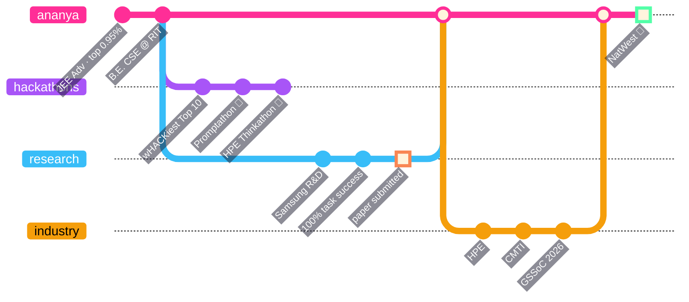
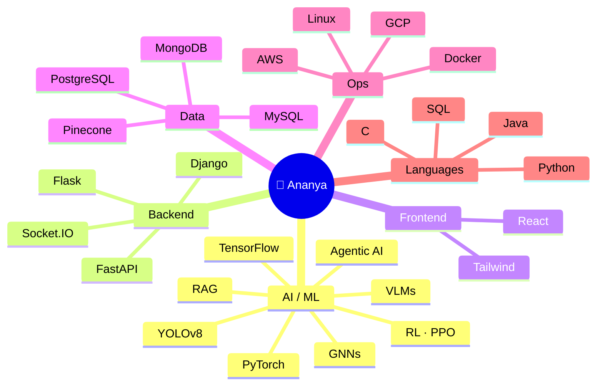

<div align="center">


<a href="https://github.com/ananyamehrotra">

</a>

<br/>

<a href="https://www.linkedin.com/in/ananya-mehrotra-079a97316"></a>
<a href="mailto:ananyamehrotra2236@gmail.com?subject=Hey%20Ananya%20%F0%9F%91%8B"></a>


</div>

<br/>

```console
ananya@pink-vscode:~$ cat status.txt
  ▸ NOW     Project Intern @ HPE — automating security compliance audits
  ▸ NOW     Intern @ CMTI — building a 5-module ERP for MSMEs
  ▸ NOW     Open Source @ GirlScript Summer of Code 2026 (AI Agent track)
  ▸ NEXT    Incoming Intern @ NatWest Group 🏦   ← loading...  ██████████░░ 83%
  ▸ PAPER   Smart App Assist → submitted to IEEE ANTS & ICVGIP 2026 📄
ananya@pink-vscode:~$ █
```

<!-- ════════════════════════  CHOOSE YOUR PATH  ════════════════════════ -->

## 🎮 Choose your player

<table>
<tr>
<td width="33%" align="center" valign="top">

### 👔 Recruiter
<sub>the 30-second version</sub>

</td>
<td width="33%" align="center" valign="top">

### 👩‍💻 Developer
<sub>show me the architecture</sub>

</td>
<td width="33%" align="center" valign="top">

### 🎲 Just vibing
<sub>who even is this</sub>

</td>
</tr>
<tr>
<td valign="top">

<details>
<summary><b>▶ press start</b></summary>
<br/>

- 🏦 **NatWest** incoming intern
- 🔐 **HPE** project intern
- 📱 **Samsung R&D** research intern
- 🏭 **CMTI** ERP intern
- 📄 1 paper under review
- 🎓 CSE @ RIT · **9.49 CGPA**
- 🎯 Top **0.95%** JEE Advanced
- 🏆 **2× winner**, **1× national runner-up**

</details>

</td>
<td valign="top">

<details>
<summary><b>▶ press start</b></summary>
<br/>

```
screenshot
   │
   ▼
YOLOv8 ─► UI elements
   │
   ▼
Qwen2.5-VL ─► (x, y)
   │   one call, grounded
   ▼
ADB / A11y ─► tap ✓
```
Fully on-device.
**94%** faster inference.
**100%** task success.

</details>

</td>
<td valign="top">

<details>
<summary><b>▶ press start</b></summary>
<br/>

- my VS Code theme is pink. non-negotiable 🩷
- I made LLMs box each other 🥊
- I sabotage hyperparameters *on purpose*
- 500+ DSA problems, still loves a hard one
- Lucknow → Bengaluru
- lo-fi + chai = prod mode

</details>

</td>
</tr>
</table>

<!-- ════════════════════════  CAREER GIT GRAPH  ════════════════════════ -->

## 🌿 `git log --graph` of my career



<!-- ════════════════════════  EXPERIENCE  ════════════════════════ -->

## 💼 Experience <sub><sup>— click to expand</sup></sub>

<details>
<summary>🏦 &nbsp;<b>NatWest Group</b> — Incoming Intern &nbsp;<code>coming soon 👀</code></summary>
<br/>

> Next quest unlocked. Banking-scale engineering incoming. Stay tuned.

</details>

<details>
<summary>🔐 &nbsp;<b>Hewlett Packard Enterprise</b> — Project Intern &nbsp;<code>Jun 2026 – now</code></summary>
<br/>

**Continuous Assurance: closing the security gap with automated checklists**
- Researched automated compliance frameworks (**CIS-CAT Pro**, **OpenSCAP**) to replace manual security audits
- Designed an **API-driven pipeline architecture** for continuous security-checklist automation, saving hours every audit cycle

</details>

<details>
<summary>🏭 &nbsp;<b>Central Manufacturing Technology Institute</b> — Intern &nbsp;<code>Aug 2026 – now</code></summary>
<br/>

**MSME ERP System** · `FastAPI` `React` `PostgreSQL`
- Specifying and building **5 core ERP modules**: Sales, Inventory, Procurement, Production, Accounts
- 📂 [`msme`](https://github.com/ananyamehrotra/msme)

</details>

<details>
<summary>📱 &nbsp;<b>Samsung R&D Institute (PRISM)</b> — Research Intern &nbsp;<code>Feb – Jun 2026</code></summary>
<br/>

**Smart App Assist: a fully local Android UI agent** · `YOLOv8` `Qwen2.5-VL` `ADB` `Accessibility Tree`

| metric | result |
|---|---|
| Task success (ADB + YOLO) | **100%** |
| Reliability (accessibility mode, n=20) | **99.3%** |
| VLM latency cut (single-call coordinate grounding) | **−94%** |
| YOLOv8 mAP50 (2,439 images · 17 classes) | **0.951** |
| Cloud dependency | **zero** |

📄 Co-authored paper, submitted to **IEEE ANTS** & **ICVGIP 2026**

</details>

<details>
<summary>🌱 &nbsp;<b>GirlScript Summer of Code 2026</b> — Open Source Contributor &nbsp;<code>May 2026 – now</code></summary>
<br/>

Shipping PRs and closing issues across the **AI Agent** and **Open Source** tracks.

</details>

<!-- ════════════════════════  PROJECTS  ════════════════════════ -->

## 🚀 Builds

<table>
<tr>
<td width="50%" valign="top">

#### 🩺 GitHopper
<sub>`Python` `Flask` `React` `Ollama` `AWS`</sub>

Paste a repo, get a health report. Automated **security review** + **tech-debt scoring** + repo **archetype classification**, powered by a multi-prompt local-LLM pipeline with dedup and confidence scoring.

[**→ repo**](https://github.com/ananyamehrotra?tab=repositories&q=githopper)

</td>
<td width="50%" valign="top">

#### 🥊 LLM Fight Club
<sub>`Python` `Socket.IO` `Groq` `Ollama` `React`</sub>

A real-time boxing arena where LLMs fight it out on live benchmarks. Provider-aware Groq/Ollama routing + a **hyperparameter sabotage** system. **−30% latency.**

[**→ repo**](https://github.com/ananyamehrotra?tab=repositories&q=fight)

</td>
</tr>
<tr>
<td width="50%" valign="top">

#### 🌍 VAAYA
<sub>`React` `Flask` `Computer Vision` `ML`</sub>

Gamified sustainable tourism. **AI-verified quests**, **CV-based proof checks**, and **predictive crowd heatmaps** so you travel smarter.

[**→ repo**](https://github.com/ananyamehrotra?tab=repositories&q=vaaya)

</td>
<td width="50%" valign="top">

#### 🏥 wHACKiest — Nationwide Health Records
<sub>`HTML` `JS` · Top 10 / 500+</sub>

A national-scale healthcare records management system, built in a hackathon sprint.

[**→ repo**](https://github.com/ananyamehrotra/whackiest)

</td>
</tr>
</table>

<!-- ════════════════════════  TROPHIES  ════════════════════════ -->

## 🏆 Trophy Room

<div align="center">

| 🥇 **Promptathon** | 🥇 **IEEE WIE EmpowerHer** | 🥈 **HPE Thinkathon** | 🔥 **wHACKiest '25** | 🔥 **HackAWAR** |
|:---:|:---:|:---:|:---:|:---:|
| Winner · 100+ teams | Winner · 50+ teams | National Runner-Up | Top 10 / 500+ | Top 6 / 250+ |

<sub>+ multiple E-Cell Business Plan wins · 5⭐ Gold Java on HackerRank · 98.7 %ile JEE Mains (99 in Maths) · 500+ DSA problems</sub>

</div>

<!-- ════════════════════════  STACK  ════════════════════════ -->

## 🧠 Brain map



<div align="center">

</div>

<!-- ════════════════════════  STATS  ════════════════════════ -->

## 📊 Live telemetry

<div align="center">


<picture>
  <source media="(prefers-color-scheme: dark)" srcset="https://raw.githubusercontent.com/ananyamehrotra/ananyamehrotra/output/snake-dark.svg"/>
  <source media="(prefers-color-scheme: light)" srcset="https://raw.githubusercontent.com/ananyamehrotra/ananyamehrotra/output/snake-light.svg"/>
  
</picture>

</div>

<!-- ════════════════════════  EASTER EGG  ════════════════════════ -->

<details>
<summary><sub>🥚 psst... don't click this</sub></summary>
<br/>

```python
>>> import ananya
>>> ananya.secret()
'you clicked it anyway. curiosity like that? we should build something together.'
>>> ananya.contact()
'ananyamehrotra2236@gmail.com  🩷'
```

</details>

<div align="center">


</div>
